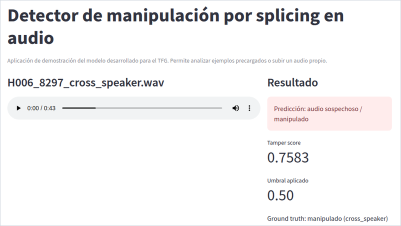
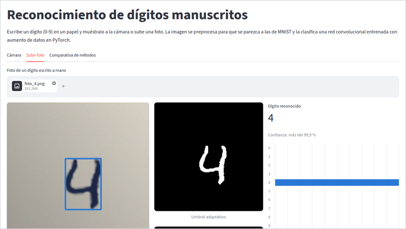
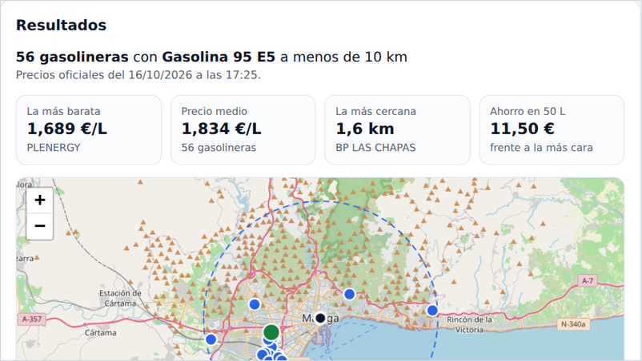

# Ángel Soler

**Aprendizaje automático · Visión artificial · Análisis de audio**

Desarrollo proyectos de **aprendizaje automático**, **visión artificial** y **análisis de audio** en Python, desde los datos hasta una demo que cualquiera puede probar. Estudio Ingeniería de Sonido e Imagen en la Universidad de Málaga y busco **prácticas en IA o ciencia de datos, en remoto, a partir de febrero de 2027**.

*Machine learning, computer vision and audio analysis projects in Python, each with a working demo. Looking for a remote AI or data science internship from February 2027.*

## Proyectos destacados

<table>
  <tr>
    <td width="33%" valign="top">
      
      <h3><a href="https://github.com/AngelorumCSE/tfg-audio-splicing-demo">Detector de manipulaciones de audio</a></h3>
      
Detecta y localiza empalmes en grabaciones de voz y genera un informe pericial en PDF con el hash SHA-256 del audio. Trabajo Fin de Grado, calificado con un 9,0.

      
<b>ROC-AUC de 0,72</b> con validación cruzada por hablante, tras detectar y corregir una fuga de datos, y de <b>0,99</b> cuando el fragmento insertado viene de otro entorno acústico.

      
Python · librosa · scikit-learn · SHAP · Streamlit

      
<a href="https://tfg-audio-splicing-demo.streamlit.app/"><b>Probar la demo</b></a> · <a href="https://github.com/AngelorumCSE/tfg-audio-splicing-demo">Código</a>

    </td>
    <td width="33%" valign="top">
      
      <h3><a href="https://github.com/AngelorumCSE/reconocimiento-digitos-manuscritos">Reconocimiento de dígitos manuscritos</a></h3>
      
Siete métodos comparados en MNIST, de plantillas con SSIM a una red convolucional, y reconocimiento en directo con la webcam y en la web.

      
<b>99,4 %</b> en test y <b>98,9 %</b> con dígitos girados y desplazados, frente al 82,5 % de una LeNet entrenada sin aumento de datos.

      
PyTorch · OpenCV · ONNX Runtime · Streamlit

      
<a href="https://digitos-mnist.streamlit.app"><b>Probar la demo</b></a> · <a href="https://github.com/AngelorumCSE/reconocimiento-digitos-manuscritos">Código</a>

    </td>
    <td width="33%" valign="top">
      
      <h3><a href="https://github.com/AngelorumCSE/gasolineras-cercanas">Gasolineras cercanas</a></h3>
      
Busca las gasolineras más baratas alrededor de un punto con los precios oficiales y las muestra en un mapa.

      
<b>De 12 MB a unos 16 KB</b> por búsqueda: una función serverless descarga solo las provincias que tocan el radio.

      
React · Leaflet · Node.js en Vercel · GitHub Actions

      
<a href="https://gasolineras-cercanas.vercel.app"><b>Probar la demo</b></a> · <a href="https://github.com/AngelorumCSE/gasolineras-cercanas">Código</a>

    </td>
  </tr>
</table>

## Lo que me interesa

- IA aplicada a señales: voz, audio e imagen.
- Evaluar bien los modelos: validación sin fuga de datos, pruebas de robustez y explicabilidad.
- Llevarlos a algo que se pueda usar: exportación a ONNX, demos web y pruebas automáticas.

## Tecnologías

**IA y datos** 

**Programación** 

**Herramientas** 

## Más sobre mí

- Colaboré en un proyecto de investigación de la Universidad de Málaga, junto a Filología Inglesa, sobre la atención en el discurso oral en inglés, en el que se analizaban señales de EEG con MATLAB e IA.
- Tercer puesto en el Vodafone Innovation Hub (2022), un reto de programación por equipos.
- Inglés B2 (Cambridge Linguaskill).

<b>In English</b>

I build machine learning, computer vision and audio analysis projects in Python, from the data to a demo anyone can try. I study Sound and Image Engineering at the University of Málaga and I'm looking for a remote AI or data science internship from February 2027.

- **Audio tampering detector** (final degree project, graded 9.0/10): locates splices in voice recordings and generates a forensic PDF report with the audio's SHA-256 hash. ROC-AUC 0.72 with speaker-grouped cross-validation, after finding and fixing a data leak, and 0.99 when the inserted segment comes from a different acoustic environment.
- **Handwritten digit recognition:** seven methods compared on MNIST, from SSIM templates to a CNN. 99.4 % test accuracy and 98.9 % on rotated and shifted digits (82.5 % for a LeNet trained without data augmentation), with a real-time webcam demo and a Streamlit app running on ONNX Runtime.
- **Nearby petrol stations:** a React and Leaflet web app whose Vercel serverless function cuts a 12 MB download to about 16 KB per search.

I also took part in a University of Málaga research project on attention in spoken English, which analysed EEG signals with MATLAB and AI, and I have a B2 level of English (Cambridge Linguaskill).

## Contacto

angel.soler.encinas@gmail.com · Málaga, España (en remoto)
